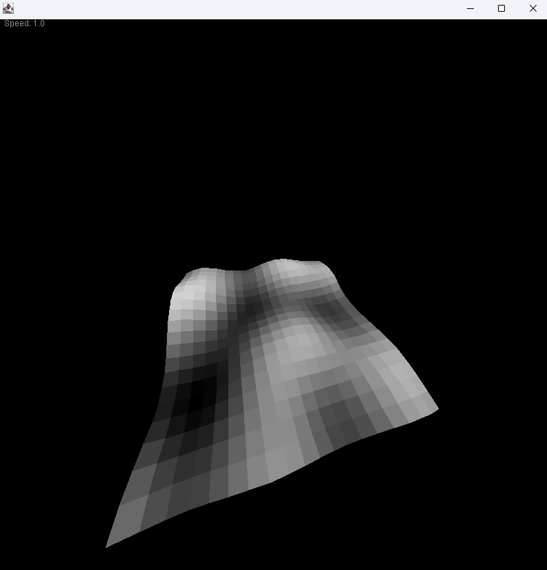
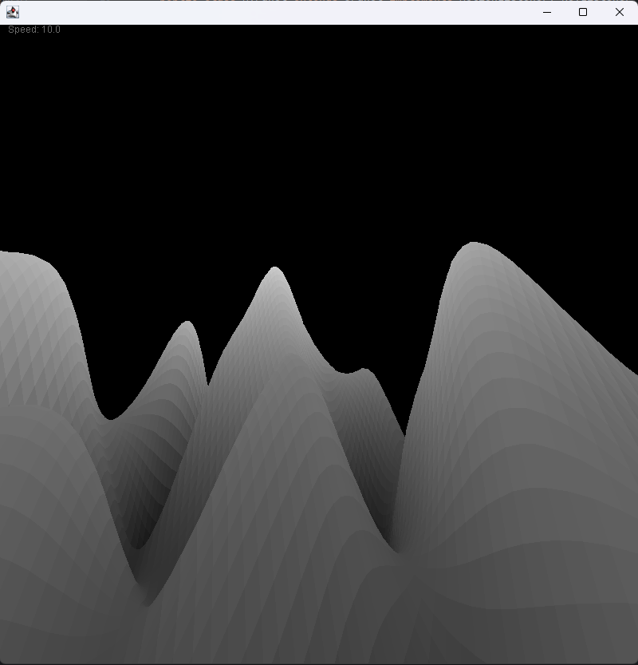

# Perlin3D: Terrain Generator and Viewer

Generates a random 3D terrain with Perlin noise implemented from scratch, then renders it as a 3D mesh you can fly around. It reuses the projection, rotation and depth-sorting code from my [3D Renderer](https://github.com/jtd6186/3D-Renderer).



## How it works

1. **Noise:** random gradient vectors are placed on a coarse grid. For each sample point, the program takes the dot product with the nearby gradients, eases the result with the quintic fade curve `6t^5 - 15t^4 + 10t^3`, and blends it with linear interpolation.
2. **Heightmap to mesh:** the noise values become heights on a 20 × 20 grid of vertices, connected into 361 quads.
3. **Rendering:** quads are projected with perspective, sorted back to front (painter's algorithm), and shaded by height, so peaks are lighter and valleys darker.

Every run uses a new random seed, so each launch produces different terrain.



## Controls

| Key | Action |
| --- | --- |
| W / S | Tilt up / down |
| A / D | Turn left / right |
| Q / E | Roll |
| Shift / Ctrl | Move closer / farther |
| = / - | Zoom in / out (field of view) |
| ] / [ | Faster / slower movement |

If the window starts mostly empty, hold Ctrl to pull the camera back.

## Run it

Requires a Java JDK (8 or newer). From the repository root:

```
javac -d out src/*.java
java -cp out Main
```

## Possible next steps

- Layer several octaves of noise for more natural detail.
- Color the terrain by height (water, sand, grass, rock, snow), as in my [2D Perlin project](https://github.com/jtd6186/Perlin).
- Increase the mesh resolution and replace the face sort with a z-buffer for speed.
